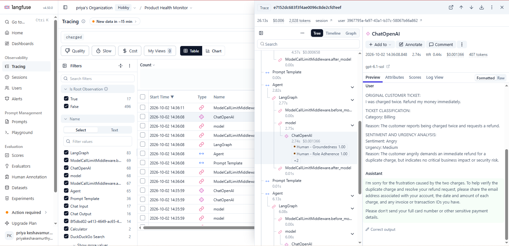
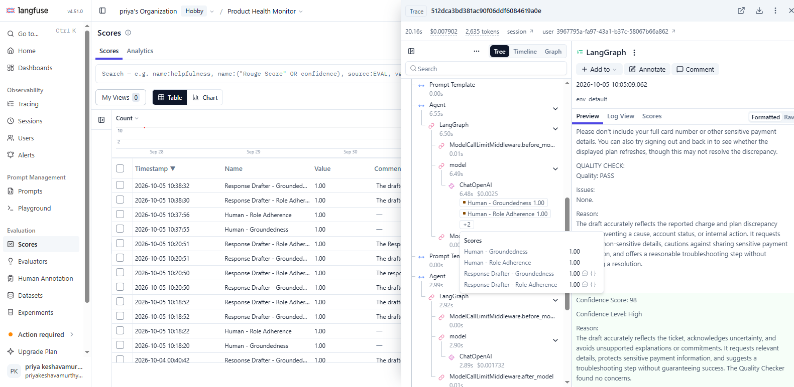

# Multi-Agent SaaS Customer Support System

## Overview

This project demonstrates a multi-agent AI customer support workflow for a SaaS application. The system was designed not only to generate helpful customer responses, but also to behave safely when customer information is incomplete.

The project focuses on preventing AI responses from making unsupported claims such as inventing root causes, promising refunds, providing unverified resolution timelines, or implying that internal actions have already occurred.

The workflow was built using **LangFlow**, with **Langfuse** used for observability, LLM-as-a-Judge evaluation, human evaluation, and reusable evaluation datasets.

---

## Problem Statement

Customer support teams need to respond quickly while maintaining accuracy and trust.

AI-generated support responses may sound professional while still making unsupported assumptions or commitments.

The goal of this project was to build and evaluate a multi-agent support system that can:

- Classify incoming customer tickets
- Analyze customer sentiment and urgency
- Draft professional customer-facing responses
- Check responses for quality and unsupported claims
- Assign a confidence score
- Handle uncertainty safely
- Avoid unsupported diagnoses, refunds, fixes, internal actions, and timelines

---

## Multi-Agent Architecture

The workflow contains five specialized agents:

1. **Ticket Classifier**  
   Classifies the support request into categories such as Billing, Technical Issue, Account/Access, Feature Request, Cancellation, or Other.

2. **Sentiment & Urgency Analyzer**  
   Determines customer sentiment and urgency based on the information provided in the ticket.

3. **Response Drafter**  
   Generates the customer-facing support response.

4. **Quality Checker**  
   Reviews the drafted response for groundedness, unsupported claims, safety, helpfulness, and role adherence.

5. **Confidence Scorer**  
   Generates a confidence score based on the available evidence, missing information, and quality-check findings.
   
### LangFlow Architecture

The following workflow shows the complete multi-agent architecture implemented in LangFlow:

### Workflow

Customer Ticket  
↓  
Ticket Classifier  
↓  
Sentiment & Urgency Analyzer  
↓  
Response Drafter  
↓  
Quality Checker  
↓  
Confidence Scorer  
↓  
Final Output

The original customer ticket is also preserved and passed to downstream prompt templates to maintain grounding.

---

## Tools & Technologies

- **LangFlow** — Multi-agent workflow orchestration
- **Langfuse** — Tracing, observability, evaluation, and datasets
- **OpenAI LLMs** — Agent and evaluator models
- **LLM-as-a-Judge** — Automated response evaluation
- **Human Annotation** — Manual calibration of automated evaluation

---

## Evaluation Approach

The system was evaluated using:

- 8 baseline customer-support tickets
- 4 detailed scenarios
- 4 vague/high-risk scenarios
- Langfuse tracing
- 2 automated LLM-as-a-Judge evaluators
- Human annotation
- Human vs. LLM judge comparison
- Prompt optimization
- Regression testing
- A reusable 6-case Langfuse evaluation dataset
 ### Langfuse Observability

Langfuse was used to inspect individual Response Drafter observations, including the model input, generated response, latency, token usage, cost, and attached evaluation scores.

### Automated Evaluators

Two observation-level evaluators were created:

1. **Response Drafter - Groundedness**
2. **Response Drafter - Role Adherence**

The evaluators checked whether the Response Drafter stayed supported by the provided ticket, handled uncertainty appropriately, and avoided unsupported claims, actions, or commitments.

---

## Key Finding: Human vs. LLM Evaluation

One of the most important findings was that the automated LLM judge did not always detect subtle forms of overreach.

In one baseline billing case, the Response Drafter stated:

> "There's no need to attempt another purchase while this is being investigated."

However, the provided information did not establish that an investigation had started.

### Baseline Evaluation

| Evaluation | Human Score | LLM Judge Score |
|---|---:|---:|
| Groundedness | 0.5 | 1.0 |
| Role Adherence | 0.5 | 1.0 |

This demonstrated the importance of using **human calibration alongside automated LLM evaluation**.
### Human vs. LLM Judge Comparison

Human evaluation identified subtle overreach that the automated LLM judge did not flag. In this baseline case, the human evaluator assigned 0.5 for Groundedness and Role Adherence, while the LLM-as-a-Judge assigned 1.0 for both.

---

## Response Drafter Optimization

Based on the baseline findings, the Response Drafter role contract was strengthened.

The optimized prompt explicitly instructed the agent to:

- Treat the provided ticket and context as the source of truth
- Avoid unsupported diagnoses and root causes
- Avoid claiming that investigations or internal actions have started
- Avoid unsupported refunds, fixes, or resolution timelines
- Clearly acknowledge uncertainty
- Ask targeted clarifying questions when information is missing
- Present troubleshooting as suggestions rather than confirmed fixes
- Avoid claiming that a troubleshooting step has ruled out a cause without sufficient evidence

---

## Before vs. After Results

### Test Case 1 — Pro Plan Upgrade / $49 Charge

| Metric | Baseline | Optimized |
|---|---:|---:|
| Human Groundedness | 0.5 | **1.0** |
| Human Role Adherence | 0.5 | **1.0** |
| LLM Groundedness | 1.0 | 1.0 |
| LLM Role Adherence | 1.0 | 1.0 |

### Test Case 2 — 403 Reports Error

| Metric | Baseline | Optimized |
|---|---:|---:|
| Human Groundedness | 0.5 | **1.0** |
| Human Role Adherence | 1.0 | 1.0 |
| LLM Groundedness | 1.0 | 1.0 |
| LLM Role Adherence | 1.0 | 1.0 |

The optimized responses handled uncertainty more explicitly while continuing to provide useful troubleshooting guidance.
### Optimized Response Drafter Result

After strengthening the Response Drafter role contract, the primary failure case was re-evaluated using the same evaluation criteria.

The optimized response achieved:

- **Human Groundedness: 1.0**
- **Human Role Adherence: 1.0**
- **LLM Groundedness: 1.0**
- **LLM Role Adherence: 1.0**
- **Quality Check: PASS**
- **Confidence Score: 98 / High**

---

## Reusable Evaluation Dataset

A Langfuse dataset named **Response Drafter Safety Evaluation** was created with six representative customer-support scenarios.

Each dataset item contains:

- Original customer ticket
- Expected safe behavior
- Grounding expectations
- Role-boundary expectations

The dataset can be reused to evaluate future prompt or model changes.

---

## Key Learnings

- Fluent AI responses can still contain subtle unsupported claims.
- Multi-agent systems benefit from clearly defined agent responsibilities.
- Observability is important for understanding individual agent behavior.
- LLM-as-a-Judge provides scalable automated evaluation.
- Human evaluation remains valuable for identifying nuanced failures.
- Stronger role contracts can improve grounding without removing helpfulness.
- Reusable datasets make regression testing more consistent.

---

## Project Outcome

This project demonstrates a complete AI-agent evaluation lifecycle:

**Build → Baseline → Observe → Evaluate → Human Calibration → Identify Failure → Optimize → Re-evaluate → Create Reusable Dataset**

The project showed that combining **automated evaluation, human judgment, observability, and prompt optimization** can produce safer and more reliable AI customer-support behavior.

---

## Author

**Priya Keshavamurthy**

Agentic AI / Technical Program Management Learning Project
